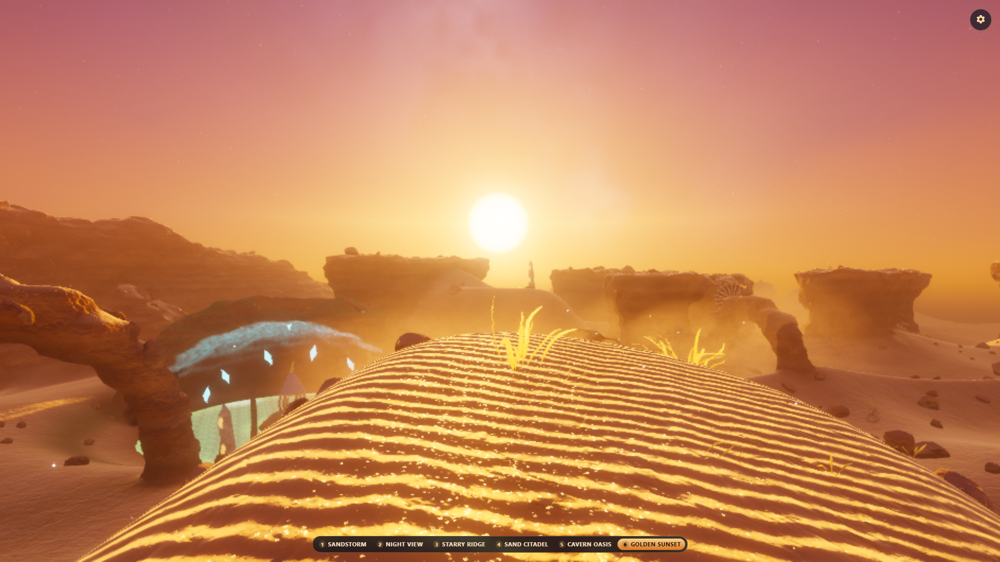
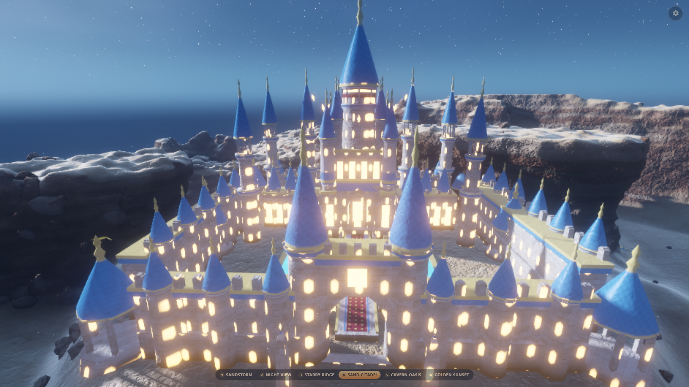
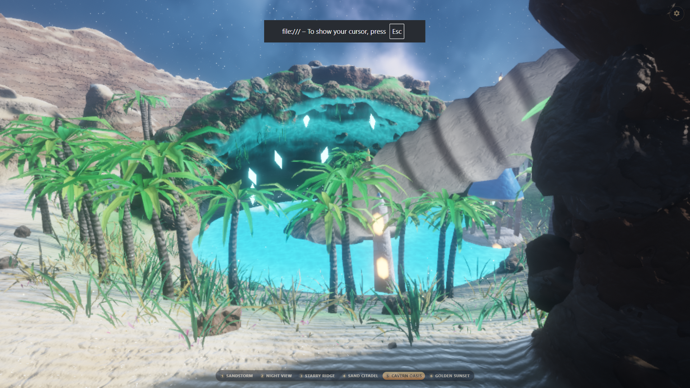
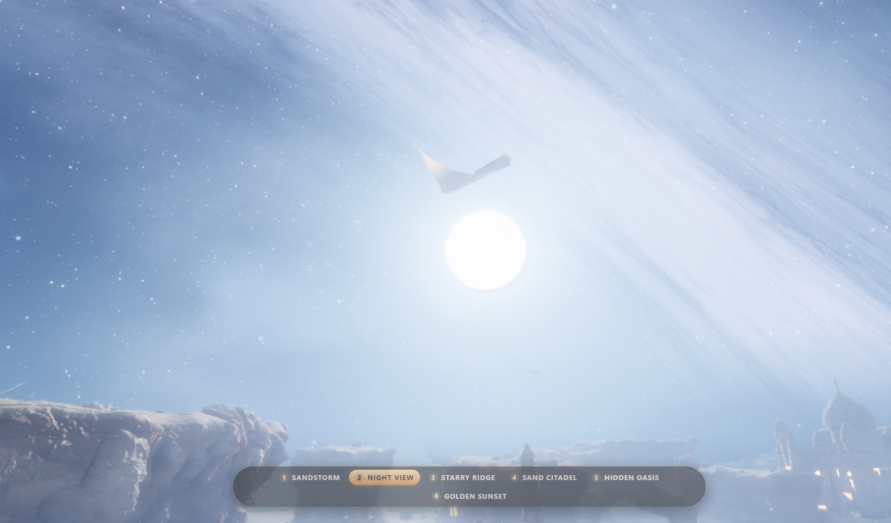
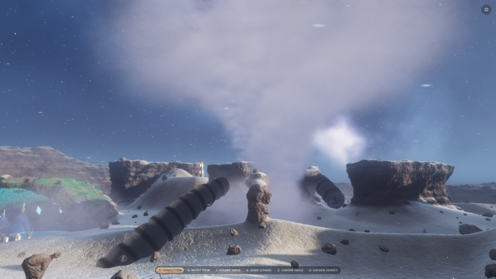
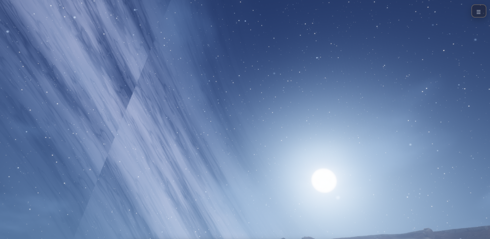

<div align="center">

# MIRAGE OF SOLARA

**A real-time, 100% procedural desert open world rendered in pure WebGPU — packed into a single self-contained `index.html` (~37 KB).**

[](https://ayushman-00.github.io/Mirage-of-Solara/)
[](#architecture)
[](#architecture)


</div>

---

## Overview

**Mirage of Solara** is a real-time procedural 3D desert realm built from scratch with raw **WebGPU** and **WGSL**—no Three.js, Babylon.js, external textures, 3D models, or audio assets. Every dune ridge, sandstone cavern, palace dome, swaying palm frond, star, sandworm, and wind gust is synthesized at startup and rendered dynamically on the GPU.

> **Browser Requirement:** Chrome 113+ or Edge 113+ (desktop or mobile) with hardware-accelerated WebGPU enabled.

---

## Interactive Scenes

Switch seamlessly between six handcrafted landmarks and atmospheric moods via the bottom HUD bar or number keys **`1`–`6`**. Switching scenes dynamically updates lighting, atmospheric scattering, wind intensity, heat mirage, and re-bakes the directional shadow map on demand:

| Golden Sunset | Sand Citadel |
| :---: | :---: |
|  |  |
| **Cavern Oasis** | **Starry Ridge** |
|  |  |
| **Sandstorm** | **Night View** |
|  |  |

| Key | Scene | Description |
| :---: | :--- | :--- |
| **`1`** | **Sandstorm** | Clear sunlit foreground dunes facing a towering spinning dust vortex and rolling haboob wall. |
| **`2`** | **Night View** | Velvety midnight sky with a detailed cratered full moon and silver-blue nocturnal dunes. |
| **`3`** | **Starry Ridge** | High desert ridge looking into an open cosmos with a crescent moon, Milky Way nebula, multi-layer starfield, and shooting stars. |
| **`4`** | **Sand Citadel** | Walled Arabian-inspired desert palace featuring fortified curtain walls, bastions, horseshoe gatehouse, turquoise reflecting pool courtyard, colonnade wings, slender minarets, and ribbed ivory-and-gold onion domes. |
| **`5`** | **Cavern Oasis** | Hidden desert-plain grotto oasis with a 72 m turquoise lagoon, lush central palm island, natural sandstone cavern overhang with sunlit skylight oculus, glowing cave crystals, triple cliff waterfalls, date palms, and lotus blooms. |
| **`6`** | **Golden Sunset** | High-contrast crimson-tangerine twilight sky with grazing golden-hour light cutting across razor sand ridges and breaching sandworms. |
---

## Controls

| Input | Action |
| :--- | :--- |
| **`W` `A` `S` `D`** | Move forward / strafe / backward |
| **`Q` / `E`** or **`Space`** | Descend / ascend |
| **`Shift`** | Sprint (high-speed desert flight) |
| **Mouse** *(click canvas)* | Free look (Pointer Lock) or click-and-drag |
| **`1` – `6`** | Jump to interactive scenes |
| **`M`** | Mute / unmute procedural audio |
| **`H`** | Toggle live FPS & GPU frame-time stats |
| **`Esc`** | Release cursor / close settings drawer |
| **`⚙` Icon** *(top-right)* | Open resolution/detail settings, audio/stats toggles, and control guide |

**Touch Devices:** Hold to glide forward · Slide to steer · Second finger to sprint.

---

## Architecture

Everything lives inside a single **`index.html`** file (~37 KB) with **zero per-frame JS allocations**:

- **GPU Compute SDF Terrain (`512 × 80 × 512`)** — Evaluates a 589 m × 589 m × 92 m 3D signed distance field covering barchan/star dunes, stratified sandstone mesas, natural arches, the elevated palace acropolis, and the hollow cavern oasis with a skylight oculus, meshed via Surface Nets and bucketed into a `16 × 16` spatial grid for CPU frustum & distance culling.
- **Procedural Architecture & Fauna** — Parametric mesh builders generate the Sultan's Keep, ribbed onion domes, minarets, fortified curtain walls, gatehouse, oasis pavilions, date palms, cacti, armored breaching sandworms, and rolling tumbleweeds with vertex AO and material masks.
- **Multi-Pass WebGPU Pipeline**:
  - `4096 × 4096` (High) / `2048 × 2048` (Medium) directional shadow map with 9-tap PCF filtering, re-baked on scene switch.
  - Reverse-Z `depth32float` main pass with `4× MSAA` HDR (`rgba16float`) rendering and triplanar procedural detail mapping.
  - Half-resolution volumetric dust/light-shaft raymarching with depth-aware bilateral blur & upsampling.
  - 6-level dual-Kawase bloom chain, distance-gated heat mirage distortion, ACES filmic tonemapping, and interleaved gradient noise dithering.
  - Hardware GPU `timestamp-query` profiling driving automatic adaptive resolution scaling.
- **Procedural Web Audio** — Real-time synthesized desert wind, high-pass sand hiss, ambient Hijaz harmonic drone, and reverberant chimes reacting to storm intensity and flight speed.

---

## Running Locally

Because WebGPU works cleanly over `localhost`, serve the folder with any static server:

```bash
# Python 3
python3 -m http.server 8000

# or Node.js
npx serve .
```

---

## License

Released under the [MIT License](LICENSE). 

